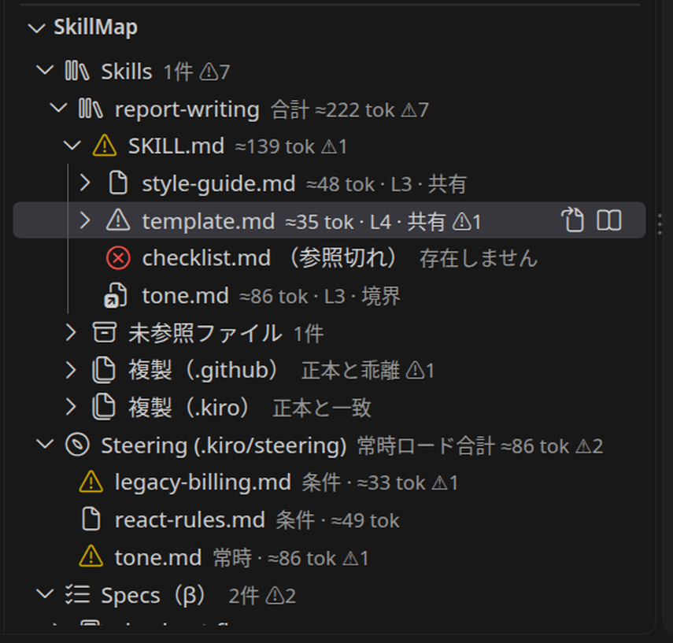
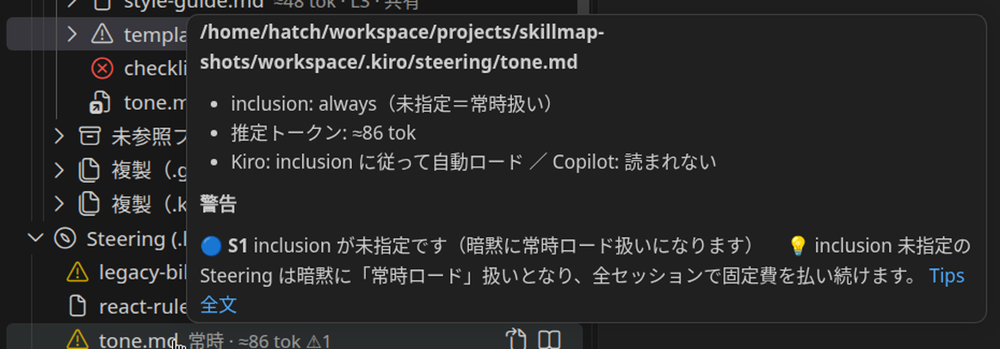

# SkillMap-Solo

[](package.json)
[](https://marketplace.visualstudio.com/items?itemName=masanori-satake.skillmap-solo)
[](https://open-vsx.org/extension/masanori-satake/skillmap-solo)
[](https://github.com/masanori-satake/SkillMap-Solo/releases)

<p align="center">
  <strong>Language / 言語:</strong> <a href="#english">English</a> | <a href="#japanese">日本語</a>
</p>

---

<a id="english"></a>
## English

**SkillMap-Solo** is a lightweight, 100% local VS Code extension that maps the *reference relationships* between your AI context files — Agent Skills, Kiro Steering/Specs, and Copilot instructions — as a tree in the Explorer.

AI context files are scattered and related: a SKILL.md points to references, references point to steering docs, and each tool (Kiro, GitHub Copilot) loads a different subset. When nobody sees the whole picture, upkeep lapses and output quality quietly degrades. SkillMap makes the structure, the token cost, and the best-practice gaps visible — and every warning comes with a **Tip** that explains why it matters and how to fix it, so you learn while you practise.

Current version: **v1.0.0**

---

<a id="en-toc"></a>
### 📑 Table of Contents

- [💡 Key Features](#en-key-features)
- [📦 Installation & Updates](#en-installation)
- [🚀 How to Use](#en-how-to-use)
- [⌨️ Commands](#en-commands)
- [🔧 Settings](#en-settings)
- [📋 Requirements](#en-requirements)
- [🔒 Data Storage & Privacy](#en-privacy)
- [🧭 Roadmap](#en-roadmap)
- [🛠️ Developer Documentation](#en-developer-docs)
- [📄 License](#en-license)

---

<a id="en-key-features"></a>
### 💡 Key Features

1. **Relationship tree, not directory tree**
   - Starting from a SKILL.md, the tree follows Markdown links and path mentions through references — across directories and layers.
   - Broken references appear as red placeholder nodes; cycles are detected and marked. Files nobody references are grouped under "Unreferenced files".

2. **Three layers of estimated token counts**
   - Each node shows its own file's estimate (hover adds the de-duplicated subtree total).
   - Selecting a node shows the **path total** from the SKILL.md root to that node in the status bar.
   - The skill root shows the whole-skill total, counting shared files only once.

3. **Best-practice warnings with Tips (R1–R11 / S1–S5)**
   - SKILL.md size budgets, description quality, reference depth, drift between a canonical skill and its copies, dead `fileMatchPattern`s, and more.
   - Every warning links to a Tip: the principle in one sentence plus a concrete fix. Warnings also appear in the Problems panel.

4. **Canonical / replica model**
   - If a canonical source (`.agents/` by default) is copied to `.kiro/` and `.github/` for different tools, the copies are grouped under the canonical skill. Rules apply to the canonical only; copies get a drift check.

5. **Steering, Specs, and Copilot instructions side by side**
   - Steering files show inclusion badges (always / conditional / manual) and the always-loaded token total — a fixed cost in every Kiro session.
   - Specs (β) show the requirements → design → tasks trio and flag missing pieces.
   - Copilot instructions are displayed read-only with their `applyTo` patterns.

6. **Load matrix and load simulation (β)**
   - The load matrix lists which files each tool (Kiro / Copilot) loads, and when.
   - The load simulation estimates, for the file you are currently editing, what Kiro and Copilot would load — side by side in the status bar.

---

<a id="en-installation"></a>
### 📦 Installation & Updates

#### From Visual Studio Marketplace / Open VSX

1. Open the Extensions view in VS Code (`Ctrl+Shift+X` / `Cmd+Shift+X`)
2. Search for "**SkillMap-Solo**"
3. Click **Install**

#### From a VSIX file

1. Download `skillmap-solo-1.0.0.vsix` from [GitHub Releases](https://github.com/masanori-satake/SkillMap-Solo/releases)
2. In VS Code, open the Command Palette (`Ctrl+Shift+P` / `Cmd+Shift+P`)
3. Run **Extensions: Install from VSIX...** and select the file

Updates are delivered through the marketplace automatically, or by installing a newer VSIX the same way.

---

<a id="en-how-to-use"></a>
### 🚀 How to Use

1. Open a workspace that contains AI context files (SKILL.md, `.kiro/steering/`, `.kiro/specs/`, `.github/copilot-instructions.md`, …).
2. The **SkillMap** view appears in the Explorer, organised into sections: Skills / Steering / Specs (β) / Copilot instructions.
3. Click a node to open the file. Hover a node to see its token breakdown and any warnings with Tip links.
4. Select a file node inside a skill to see the path total in the status bar.
5. Run **SkillMap: Show Load Matrix (per tool)** from the view title bar to compare what Kiro and Copilot load.
6. While editing any file, the status bar (β) shows the simulated load for that file: `Kiro ≈X / Copilot ≈Y tok`.






**Note on token counts:** all token figures are *estimates* based on character types (roughly 1 token per Japanese character, 1 token per 4 alphanumeric characters). They are meant for comparing and budgeting, not billing.

---

<a id="en-commands"></a>
### ⌨️ Commands

| Command | Description |
|---|---|
| `SkillMap: Refresh` | Re-scan the workspace |
| `SkillMap: Show Tip` | Open the full Tip for the selected warning |
| `SkillMap: Open File` | Open the file for the selected node |
| `SkillMap: Show Load Matrix (per tool)` | Open the per-tool load matrix as Markdown |

---

<a id="en-settings"></a>
### 🔧 Settings

| Setting | Default | Description |
|---|---|---|
| `skillmap.canonicalRoots` | `[".agents"]` | Directories treated as the canonical source (priority order) |
| `skillmap.skillsRoots` | `[]` | Extra directories to scan for SKILL.md files |
| `skillmap.rules.skillBodyMaxTokens` | `5000` | R5: SKILL.md estimated-token budget (0 disables) |
| `skillmap.rules.skillBodyMaxLines` | `500` | R4: SKILL.md body line budget (0 disables) |
| `skillmap.rules.descriptionMaxLength` | `1024` | R2: frontmatter description length limit (0 disables) |
| `skillmap.rules.maxReferenceDepth` | `2` | R6: reference depth warning threshold (0 disables) |
| `skillmap.rules.skillTotalTokenBudget` | `0` | R10: whole-skill total token budget (0 disables) |
| `skillmap.rules.orphanFiles` | `info` | R9: severity for unreferenced files (`off` / `info` / `warn`) |
| `skillmap.rules.steeringAlwaysTokenBudget` | `0` | S3: budget for always-loaded steering total (0 disables) |
| `skillmap.beta.specs` | `true` | β: show the Specs section |
| `skillmap.beta.loadSimulation` | `true` | β: show the load simulation in the status bar |

---

<a id="en-requirements"></a>
### 📋 Requirements

- **VS Code**: version 1.90.0 or later
- **Workspace**: a folder containing SKILL.md files or `.kiro/` / `.github/` context files (an empty view is shown otherwise)
- No accounts, no API keys, no network access required.

---

<a id="en-privacy"></a>
### 🔒 Data Storage & Privacy

- **100% local processing**: all analysis runs on your machine. The extension never sends your files, file names, or usage data anywhere. No telemetry, no tracking.
- **Read-only**: the extension never modifies your files.
- No settings or caches are written outside VS Code's standard configuration.

---

<a id="en-roadmap"></a>
### 🧭 Roadmap

- Discovery of personal (user-level) skill directories
- A richer Tip viewer (Webview) — Tip data is already presentation-independent
- Support for more context formats via the adapter design (Kiro Steering/Specs and Copilot instructions landed in 1.0.0)
- Feedback on the β features (Specs / load simulation) is welcome via GitHub Issues

---

<a id="en-developer-docs"></a>
### 🛠️ Developer Documentation

- Development and release rules for contributors and AI agents: [AGENTS.md](AGENTS.md)
- Build & test:

```bash
npm install
npm test          # unit tests
npm run compile   # check-version + check-types + lint (incl. README anchor check) + esbuild
npm run package   # production build
```

---

<a id="en-license"></a>
### 📄 License

MIT License - see the [LICENSE](LICENSE) file for details.

---

<a id="japanese"></a>
## Japanese (日本語)

**SkillMap-Solo** は、AI コンテキストファイル（Agent Skills、Kiro Steering/Specs、Copilot instructions）の**参照関係**をエクスプローラーにツリー表示する、軽量・100%ローカルの VS Code 拡張機能です。

AI コンテキストファイルは散在し、関係し合っています。SKILL.md が references を指し、references が Steering を指し、そしてツール（Kiro、GitHub Copilot）ごとに読み込む範囲が違います。全体像が見えないと保守が後回しになり、出力の精度は静かに落ちていきます。SkillMap は構造と読み込みコストとベストプラクティスからのズレを見える化し、すべての警告に「なぜ問題か＋直し方」の **Tips** を付けます。実践しながら理解できることが、この拡張機能の核です。

現在のバージョン: **v1.0.0**

---

<a id="ja-toc"></a>
### 📑 目次

- [💡 主な機能](#ja-key-features)
- [📦 インストール/アップデート方法](#ja-installation)
- [🚀 使い方](#ja-how-to-use)
- [⌨️ コマンド](#ja-commands)
- [🔧 設定](#ja-settings)
- [📋 動作要件](#ja-requirements)
- [🔒 データの保存について](#ja-privacy)
- [🧭 ロードマップ](#ja-roadmap)
- [🛠️ 開発者向けドキュメント](#ja-developer-docs)
- [📄 ライセンス](#ja-license)

---

<a id="ja-key-features"></a>
### 💡 主な機能

1. **ディレクトリではなく「関係」のツリー**
   - SKILL.md を起点に、Markdown リンクとパス記述をたどって references を階層・ディレクトリを跨いで表示します。
   - 参照切れは赤いプレースホルダーで表示し、循環も検出します。どこからも参照されていないファイルは「未参照ファイル」にまとめます。

2. **推定トークン数の3層表示**
   - 各ノードに自ファイルの推定値を表示（ホバーで重複排除した配下合計も）。
   - ノード選択時は、SKILL.md からそのノードまでの**経路合計**をステータスバーに表示します。
   - スキルのルートには、共有ファイルを1回だけ数えたスキル全体の合計を表示します。

3. **Tips 付きベストプラクティス警告（R1–R11 / S1–S5）**
   - SKILL.md のサイズ予算、description の質、参照の深さ、正本と複製のドリフト、実ファイルに一致しない fileMatchPattern など。
   - すべての警告に Tips（原則1文＋具体的な直し方）へのリンクが付きます。警告は Problems パネルにも出ます。

4. **正本／複製モデル**
   - 正本（既定は `.agents/`）が `.kiro/` や `.github/` にツール別に複製されている構成では、複製を正本の下にグループ表示します。ルールは正本のみ、複製はドリフトチェックのみです。

5. **Steering / Specs / Copilot instructions を並べて表示**
   - Steering は inclusion バッジ（常時／条件／手動）と常時ロード合計（Kiro の全セッションの固定費）を表示します。
   - Specs（β）は requirements → design → tasks の3点セットと欠けを表示します。
   - Copilot instructions は applyTo とともに読み取り表示します。

6. **ロードマトリクスとロードシミュレーション（β）**
   - ロードマトリクスで「どのファイルが・どのツールで・いつ読まれるか」を一覧できます。
   - ロードシミュレーションは、編集中のファイルに対して Kiro と Copilot が読み込む推定トークンをステータスバーで対比します。

---

<a id="ja-installation"></a>
### 📦 インストール/アップデート方法

#### Visual Studio Marketplace / Open VSX から

1. VS Code の拡張機能ビューを開く（`Ctrl+Shift+X` / `Cmd+Shift+X`）
2. 「**SkillMap-Solo**」で検索する
3. **インストール** をクリックする

#### VSIX ファイルから

1. [GitHub Releases](https://github.com/masanori-satake/SkillMap-Solo/releases) から `skillmap-solo-1.0.0.vsix` をダウンロードする
2. コマンドパレット（`Ctrl+Shift+P` / `Cmd+Shift+P`）を開く
3. **Extensions: Install from VSIX...** を実行し、ファイルを選ぶ

アップデートは Marketplace 経由で自動配信されるほか、新しい VSIX を同じ手順でインストールしても行えます。

---

<a id="ja-how-to-use"></a>
### 🚀 使い方

1. AI コンテキストファイルを含むワークスペースを開きます（SKILL.md、`.kiro/steering/`、`.kiro/specs/`、`.github/copilot-instructions.md` など）。
2. エクスプローラーに **SkillMap** ビューが現れます。セクションは Skills / Steering / Specs（β）/ Copilot instructions です。
3. ノードをクリックするとファイルが開きます。ホバーでトークン内訳と警告（Tips へのリンク）が見られます。
4. スキル内のファイルノードを選ぶと、ステータスバーに経路合計が出ます。
5. ビューのタイトルバーから **SkillMap: ツール別ロードマトリクスを表示** を実行すると、Kiro と Copilot の読み込み範囲を比べられます。
6. 任意のファイルの編集中は、ステータスバー（β）にそのファイルへのロードシミュレーション（`Kiro ≈X / Copilot ≈Y tok`）が出ます。


**トークン数について：** すべてのトークン数は文字種ベースの**推定**です（日本語は約1文字＝1トークン、英数字は約4文字＝1トークン）。比較と予算管理のための目安であり、課金の実測値ではありません。

---

<a id="ja-commands"></a>
### ⌨️ コマンド

| コマンド | 説明 |
|---|---|
| `SkillMap: 再読み込み` | ワークスペースを再スキャンする |
| `SkillMap: Tipsを表示` | 選択中の警告の Tips 全文を開く |
| `SkillMap: ファイルを開く` | 選択中のノードのファイルを開く |
| `SkillMap: ツール別ロードマトリクスを表示` | ツール別の読み込み一覧を Markdown で開く |

---

<a id="ja-settings"></a>
### 🔧 設定

| 設定 | 既定値 | 説明 |
|---|---|---|
| `skillmap.canonicalRoots` | `[".agents"]` | 正本とみなすディレクトリ（優先順） |
| `skillmap.skillsRoots` | `[]` | SKILL.md を探す追加ディレクトリ |
| `skillmap.rules.skillBodyMaxTokens` | `5000` | R5: SKILL.md の推定トークン上限（0で無効） |
| `skillmap.rules.skillBodyMaxLines` | `500` | R4: SKILL.md 本文の行数上限（0で無効） |
| `skillmap.rules.descriptionMaxLength` | `1024` | R2: description の文字数上限（0で無効） |
| `skillmap.rules.maxReferenceDepth` | `2` | R6: 参照の深さの警告しきい値（0で無効） |
| `skillmap.rules.skillTotalTokenBudget` | `0` | R10: スキル全体の合計予算（0で無効） |
| `skillmap.rules.orphanFiles` | `info` | R9: 未参照ファイルの警告レベル（`off` / `info` / `warn`） |
| `skillmap.rules.steeringAlwaysTokenBudget` | `0` | S3: Steering 常時ロード合計の予算（0で無効） |
| `skillmap.beta.specs` | `true` | β: Specs セクションの表示 |
| `skillmap.beta.loadSimulation` | `true` | β: ステータスバーのロードシミュレーション表示 |

---

<a id="ja-requirements"></a>
### 📋 動作要件

- **VS Code**: 1.90.0 以降
- **ワークスペース**: SKILL.md または `.kiro/` / `.github/` のコンテキストファイルを含むフォルダ（無ければビューは空になります）
- アカウント・API キー・ネットワーク接続は不要です。

---

<a id="ja-privacy"></a>
### 🔒 データの保存について

- **100%ローカル処理**： 解析はすべてお使いのマシン内で完結します。ファイルやファイル名、利用状況を外部に送信することは一切ありません。テレメトリ・トラッキングもありません。
- **読み取り専用**： ファイルを変更することはありません。
- VS Code の標準設定以外の場所にデータやキャッシュを書きません。

---

<a id="ja-roadmap"></a>
### 🧭 ロードマップ

- 個人（ユーザーレベル）ディレクトリのスキル探索
- Tips ビューアの Webview 化（Tips データは既に表示層から分離済み）
- アダプタ設計による対応形式の追加（1.0.0 で Kiro Steering/Specs と Copilot instructions に対応）
- β機能（Specs / ロードシミュレーション）へのフィードバックは GitHub Issues で歓迎します

---

<a id="ja-developer-docs"></a>
### 🛠️ 開発者向けドキュメント

- 開発・リリースのルール（貢献者と AI エージェント向け）: [AGENTS.md](AGENTS.md)
- ビルドとテスト:

```bash
npm install
npm test          # 単体テスト
npm run compile   # check-version + 型チェック + lint（README アンカーチェック含む）+ esbuild
npm run package   # 本番ビルド
```

---

<a id="ja-license"></a>
### 📄 ライセンス

MIT License - 詳細は [LICENSE](LICENSE) ファイルを参照してください。
